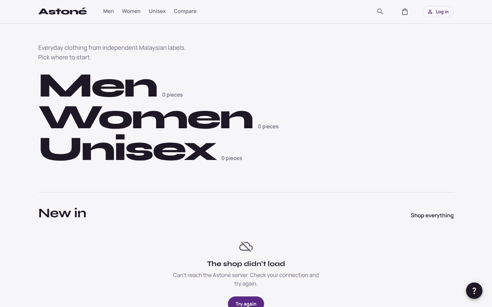
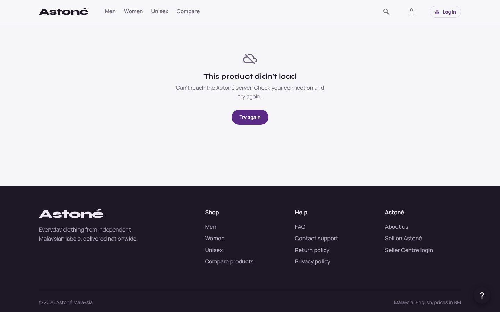
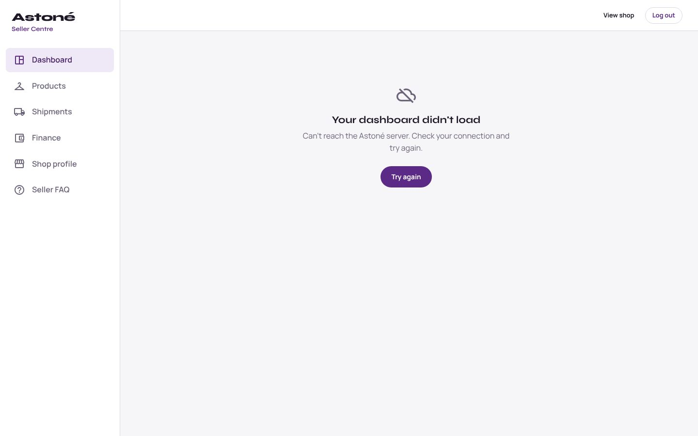

# Astoné

Astoné is a marketplace for everyday clothing from independent Malaysian labels. Shoppers browse by category, compare pieces, check out with loyalty points and follow their orders. Sellers get a Seller Centre to list products, run promotions, ship orders and see their sales.

**Live demo:** [astone-lovat.vercel.app](https://astone-lovat.vercel.app)

> The API runs on Render's free tier, so the first request after a quiet spell can take 30 to 60 seconds while it wakes up.

| Shop | Product | Seller Centre |
| --- | --- | --- |
|  |  |  |

## Stack

- **Frontend** (`Project/frontend`): React 18, Vite, Material UI, React Router. Tested with Vitest and Testing Library. Deployed on Vercel.
- **Backend** (`Project/astone`): Django 5, Django REST Framework, JWT auth (SimpleJWT), PostgreSQL. Deployed on Render, with optional Cloudinary storage for product photos.

## Run it locally

You need Node 18+ and either Docker or Python 3.12 with PostgreSQL.

### Backend with Docker (easiest)

```bash
cd Project/astone
cp .env.example .env
```

Open `.env` and set the database values (any values work locally):

```
SQL_NAME=astone_db
SQL_USER=astone
SQL_PASSWORD=astone123
```

Then start it:

```bash
docker compose up --build
```

In a second terminal, load the demo data:

```bash
cd Project/astone
docker compose exec web python manage.py seed_demo
```

The API is now at http://localhost:8000.

### Backend without Docker

```bash
cd Project/astone
cp .env.example .env            # set DATABASE_URL to your local PostgreSQL
pip install -r requirements.txt
python manage.py migrate
python manage.py seed_demo      # optional: demo products and logins
python manage.py runserver
```

### Frontend

```bash
cd Project/frontend
cp .env.example .env.local      # VITE_API_URL=http://localhost:8000
npm install
npm run dev                     # http://localhost:5173
```

### Demo logins

Created by `seed_demo`. Delete or change them before a real launch, since they are public.

- Shopper: `demo@astone.my` / `astone-demo-1`
- Seller: `seller@astone.my` / `astone-demo-1`

## Tests

```bash
cd Project/astone && python manage.py test astoneapp    # 32 API tests
cd Project/frontend && npm test && npm run lint          # 35 UI tests, zero lint warnings
```

GitHub Actions runs both suites on every push and pull request (`.github/workflows/ci.yml`).

## Deploying

The frontend goes on Vercel and the backend and database go on Render. Full steps and troubleshooting are in [DEPLOYMENT.md](./DEPLOYMENT.md). In short:

1. **Backend (Render):** New → Blueprint, pick this repo. `render.yaml` creates the web service and the PostgreSQL database. Set `FRONTEND_URL` and `CORS_ALLOWED_ORIGINS_DEPLOY` to your Vercel URL and `CSRF_TRUSTED_ORIGINS_DEPLOY` to your Render URL.
2. **Frontend (Vercel):** import the repo, set the **Root Directory** to `Project/frontend`, and add `VITE_API_URL` pointing at your Render URL. Redeploy after changing it, because Vite bakes it in at build time.

Common gotchas:

- Origins in the CORS and CSRF variables must have no trailing slash and no path.
- If `npm ci` complains that the lock file is out of sync, regenerate it with `rm -rf node_modules package-lock.json && npm install` and commit the new `package-lock.json`.
- Without Cloudinary credentials, uploaded product photos are lost on every Render redeploy.

## How accounts and security work

- Shoppers and sellers both log in with JWTs. Every endpoint that touches personal data (bag, orders, profile) works only for the logged-in account; there are no email-in-the-URL lookups.
- Sellers can only edit, delete or discount their own products, and only see their own orders.
- Prices, stock and points are calculated on the server when an order is placed, so they can't be changed from the browser.
- Password reset links contain a signed token that expires after 24 hours and stops working once used.
- No secrets live in the code: everything comes from environment variables (see `Project/astone/.env.example`). Never commit a real `.env`.

## Pull Requests

### Creating Pull Requests

1. **Write small PRs**
Aim to create small, focused pull requests that fulfill a single purpose.

2. **Review your own PR**
Before requesting a review, ensure that your code is clean, well-documented, and follows the project's coding standards.

3. **Test your own PR**
Build and test your own pull requests before submitting it. This allows you to catch errors or typos before reviewers see them.

4. **Provide context**
Explain the purpose of your PR and provide any necessary context to help reviewers understand your changes within the title and description.

### Managing Pull Requests

1. **Define code owners**
After a handover, assign code owners to each part of the codebase or the whole codebase. This ensures that the right people are notified when a PR is created and can handle the review process.

2. **Use protected branches**
Protect the main branch to prevent direct commits and ensure that all changes are made through pull requests. This allows for code reviews and ensures that the main branch is always stable.

## Versioning Strategy

We follow a trunk-based development methodology with three main branches to ensure a stable and organized codebase. This strategy helps in managing releases and feature development efficiently.

### Branch Types

1. **Main Branch**:
   - The `main` branch contains the stable, production-ready code. Direct commits to this branch are restricted to ensure stability.

2. **Development Branches**:
   - The development branches are other branches based on `main` branch used for integrating features and testing them before merging into the `main` branch. It serves as a staging area for the next release. Development branches are named based on group and user story associate with the implemented feature where the format is groupX-feature/USXX-user_story_name. For example, `group3-feature/US40-notification-for-new-order`.

3. **Release Branches**:
   - Release branches are created from the `main` branch when preparing for a new release. This allows for final testing and bug fixes on the `main` branch before merging into release branches.
   - Naming convention: release/version-number

### Version Numbering

We use Semantic Versioning (SemVer) to assign version numbers to releases. The format is MAJOR.MINOR, where:

- **MAJOR**: Incremented for major updates and changes to the application such as new features added for each milestone.
- **MINOR**: Incremented for minor changes such as bug fixes and to resolve issues with integration.

### Workflow

1. **Developing Features**:
   - Develop features directly in the development branches.
   - Ensure all changes are thoroughly tested before merging into `main` branch after features have been implemented.

2. **Preparing a Release**:
   - Create a release branch from `main`: git checkout -b release/version-number development
   - Perform final testing and bug fixes.
   - Merge the release branch into release: git checkout main && git merge release/version-number
   - Tag the release: git tag -a version-number -m "Release version-number"
   - Merge the main branch back into development branches: git checkout development && git merge main
   - Delete the release branch: git branch -d release/version-number

By following this versioning strategy, we ensure that our codebase remains stable, organized, and easy to manage.

### Open License

Astone is licensed under the [GNU General Public License v3.0](./LICENSE).
